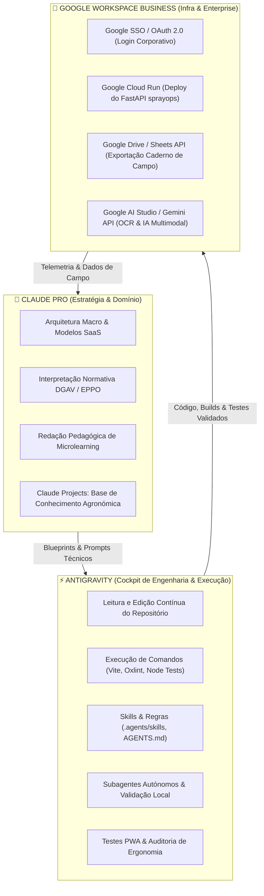

# 🚀 Otimização do Antigravity no Ecossistema DATERRA Smart (PWA SaaS)

**Projeto:** DATERRA Smart (PWA SaaS Suite Agrícola Offline-First)  
**Enquadramento:** PRR - Projeto N.º 23703 (AgroSmart DATERRA)  
**Ambiente de Engenharia:** Antigravity (Google DeepMind) + Claude Pro + Google Workspace Business Standard  

---

## 1. Diagnóstico do Projeto & Estado Atual

A análise detalhada ao repositório `daterra-smart-app` revela uma base técnica excecionalmente bem estruturada, madura e rigorosa:
* **Frontend PWA:** React 19.2 + TypeScript + Vite 8.2 + Tailwind CSS 4.3.
* **Offline-First Engine:** Dexie.js 4.4 (IndexedDB) com persistência local de culturas, equipamentos, ensaios e histórico.
* **Rigor Agronómico & Legal:** 132 testes automatizados em Node.js (`test/*.test.mjs`) que validam modelos **EPPO PP 1/239**, **LWA-V DATERRA**, **TRV**, **Decreto-Lei n.º 91/2016** (drones e faixas de proteção) e o catálogo de bicos ISO.
* **Backend & Microsserviços:** Supabase (Auth, RLS, Edge Functions como `send-otp`) e microsserviço Python FastAPI (`services/sprayops`) para conformidade legal e geração de PDFs.
* **Internacionalização:** 8 dicionários completos (`pt`, `br`, `en`, `es`, `fr`, `it`, `de`, `el`).

---

## 2. A Tríade Produtiva: Divisão Estratégica de Papéis

Para maximizar a produtividade e eliminar atritos, cada ferramenta deve operar na sua zona de excelência máxima:

---

## 3. Como Otimizar e Potenciar o Antigravity na DATERRA Smart

### 3.1. Implementação de Regras Hierárquicas (`AGENTS.md`)
Atualmente, o projeto não possui um ficheiro `AGENTS.md` na raiz. A criação deste ficheiro é o passo com maior retorno imediato, pois injeta restrições contínuas (*always-on*) no raciocínio do modelo:
1. **Regra de Terminologia Agronómica PT-PT:** Proibir termos como *"cuba"* (usar *"depósito"*), *"PF"* (usar *"produto fitofarmacêutico"*), *"taxa"* para volume de calda (usar *"volume de calda sugerido"* ou *"débito"*).
2. **Regra de Qualidade de Código:** Obrigação de correr `oxlint` e a suite `node test/*.test.mjs` antes de dar qualquer funcionalidade como concluída.
3. **Regra de Segurança & Proteção de Dados:** Proibir absolutamente a escrita ou commit de credenciais (`.env`, passwords cPanel FTP, chaves secretas Supabase).
4. **Ergonomia de Campo:** Garantir que novos inputs utilizem o `DaterraKeypad` e cumpram a área mínima de toque de 48px (`.touch-target`).

### 3.2. Ativação do Arsenal de Skills (`.agents/skills/`)
No documento `docs/arquitetura/15_BlocoGoogleAIStudio.md`, foram projetadas 12 skills de alto valor que ainda não foram migradas para pastas executáveis em `.agents/skills/`. Recomenda-se criar:
* `agri-formula-validator`: Garante postura anti-alucinação na implementação de fórmulas matemáticas agronómicas (TRV, LWA, débito unitário, Swath Width).
* `mobile-ux-field-tools`: Valida teclado numérico contextual, contraste solar, ausência de hover e responsividade vertical.
* `pwa-shell-architect`: Gere estratégias de cache do Workbox, Service Worker e integridade do Dexie.js 4.
* `weather-api-integrator`: Padroniza chamadas a modelos meteorológicos e cálculo de risco de deriva.

### 3.3. Uso de Subagentes Especializados
O Antigravity permite instanciar subagentes com focos isolados para evitar saturação de contexto:
* **`agronomy-tester`**: Subagente focado em executar e criar cenários de teste em `test/` baseados nas normas EPPO e DGAV.
* **`i18n-checker`**: Subagente para validar que qualquer alteração num ficheiro de tradução (`src/i18n/locales/pt.json`) é sincronizada de forma coerente nos restantes 7 idiomas.
* **`bundle-optimizer`**: Subagente focado na otimização de performance do Vite (eliminar o warning de chunk > 500kB nos dados de bicos).

### 3.4. Otimização de Performance da PWA (Code-Splitting)
A compilação do Vite revelou dois blocos pesados:
* `dist/assets/nozzle-data-*.js`: **1,54 MB**
* `dist/assets/index-*.js`: **2,12 MB**
* Precache da PWA: **4,33 MB**

**Otimização com Antigravity:**
Configurar o carregamento dinâmico (`React.lazy()` / `import()`) para o catálogo de bicos e ferramentas avançadas. Dessa forma, o agricultor no campo descarrega um shell inicial de apenas ~250 kB, tornando a abertura da PWA instantânea mesmo em ligações 3G lentas.

---

## 4. Integração Estratégica do Claude Pro

O Claude Pro deve ser utilizado como o **Conselheiro Estratégico & Redator Regulamentar**:

1. **Configuração de um "Claude Project" dedicado:**
   * Nome: `DATERRA Smart - Agronomia & Arquitetura SaaS`.
   * Ficheiros de Contexto: `docs/PLANO_DESENVOLVIMENTO_DATERRA_SMART_SAAS.md`, `docs/RELATORIO_ESTADO_DESENVOLVIMENTO.md`, manuais da DGAV e normas EPPO.
2. **Tarefas Ideais para o Claude Pro:**
   * **Conceção de Novos Módulos:** Estruturar a lógica de negócio do Caderno de Campo Digital, compatibilidade de misturas ou planeamento de voo de drones.
   * **Redação de Microlearning Pedagógico:** Gerar textos didáticos com linguagem precisa em português de Portugal para as FAQs contextuais da app.
   * **Validação de Modelo de Negócio SaaS:** Desenhar a arquitetura de permissões multi-tenant (Administrador de Cooperativa vs. Engenheiro Agrónomo vs. Operador de Trator).
3. **Transição Claude -> Antigravity:**
   * O Claude produz a especificação ou o prompt detalhado.
   * O Antigravity recebe a especificação, gera os ficheiros no código-fonte, atualiza os testes unitários e valida a compilação localmente.

---

## 5. Alavancagem do Google Workspace Business Standard

A subscrição Google Workspace Business Standard oferece capacidades de classe empresarial que resolvem múltiplos desafios do SaaS:

### 5.1. Identidade & Autenticação (Google Identity / SSO)
* Configurar o fornecedor **Google OAuth no Supabase Auth**.
* Permitir aos agricultores, cooperativas e técnicos autenticarem-se com um clique via conta Google.
* Utilizar o domínio `@daterra.pt` para gerir acessos administrativos e contas de serviço com políticas estritas de segurança.

### 5.2. Integração com Google Drive & Sheets API (Caderno de Campo Digital)
* Em Portugal, a maioria das explorações agrícolas mantém registos de tratamentos em folhas de cálculo Excel/Google Sheets.
* **Funcionalidade SaaS de Alto Valor:** Criar uma integração onde os tratamentos registados offline na PWA são sincronizados com o Supabase e exportados automaticamente para uma folha de cálculo no Google Drive do agricultor, formatada de acordo com o modelo oficial da DGAV.
* O ficheiro raiz `FlowRate_Nozzles.xlsx` pode ser sincronizado a partir de uma Google Sheet mestra da equipa agronómica.

### 5.3. Google Cloud Platform (GCP) & Cloud Run
Com o Google Workspace, o projeto beneficia de uma conta organizacional no GCP:
* **Hospedagem do Microsserviço SprayOps:** O serviço Python FastAPI em `services/sprayops/` pode ser implantado em **Google Cloud Run** com escalamento a zero (custo mínimo e performance máxima para geração de PDFs oficiais e validação de buffers de pulverização).
* **Armazenamento de Relatórios e Evidências:** Google Cloud Storage para ficheiros de calibração e imagens de ensaios em papel hidrossensível.

### 5.4. Google AI Studio & Gemini API
* Utilização de chaves de API empresariais para recursos de visão computacional:
  * **OCR de Rótulos Fitofarmacêuticos:** O agricultor tira uma foto ao rótulo do produto no campo e o Gemini extrai automaticamente a dose recomendada (L/ha ou g/hL), substância ativa e intervalo de segurança.
  * **Análise de Papel Hidrossensível:** Leitura preliminar de densidade de gotas (gotas/cm²) para calibração de drones e pulverizadores.

---

## 6. Roteiro Tático de Implementação

| Fase | Ação | Ferramenta Principal | Impacto |
| :--- | :--- | :--- | :--- |
| **1** | Criar `AGENTS.md` com diretrizes agronómicas, terminologia PT-PT e checagens obrigatórias | Antigravity | Imediato (Consistência de código e zero alucinações) |
| **2** | Migrar as 3 skills essenciais (`agri-formula-validator`, `mobile-ux-field-tools`, `pwa-shell-architect`) | Antigravity | Alto (Aceleração do desenvolvimento de calculadoras) |
| **3** | Otimizar chunks do Vite com Code-Splitting dinâmico no catálogo de bicos | Antigravity | Alto (Carregamento rápido no campo em 3G/4G) |
| **4** | Criar Projeto no Claude Pro com toda a base documental de `docs/` e manuais DGAV | Claude Pro | Médio/Longo (Riqueza pedagógica e rigor de arquitetura) |
| **5** | Configurar Google OAuth no Supabase e pipeline Cloud Run para `services/sprayops` | Google Workspace + Antigravity | Estrutural (Prontidão para SaaS B2B) |
