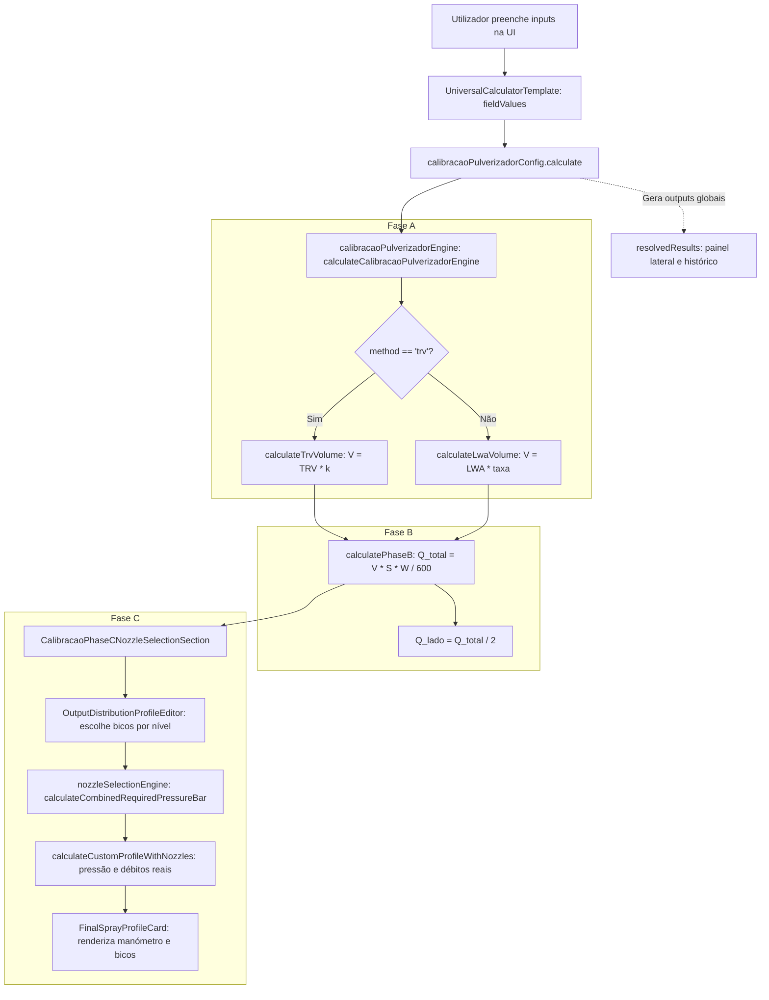

# AUDITORIA INTEGRAL — CALIBRAÇÃO PULVERIZADOR
**DATERRA Smart | `calc_calibracao_pulverizador`**  
**Fases A, B e C | Matemática, Dados, UX/UI, Fluxo e Regressões**

---

## 1. DATA E ÂMBITO DA AUDITORIA

- **Data da Auditoria:** 2026-09-08
- **Auditor:** Agente Especializado em Engenharia de Software e Agronomia DATERRA Smart
- **Identificador da Ferramenta:** `calc_calibracao_pulverizador`
- **Ambiente Analisado:** Repositório local DATERRA Smart (Branch: `main`)
- **Modo de Operação:** **Leitura Estrita (Read-Only)**. Não foram feitas alterações em código-fonte de produção, ficheiros de teste, bases de dados (Dexie/IndexedDB) nem no repositório Git (`git commit`/`git push`).
- **Âmbito da Auditoria:**
  1. **Fase A (Volume de Calda):** Modelos canónicos TRV (Tree Row Volume com matriz EPPO) e LWA (Leaf Wall Area com taxa hídrica específica).
  2. **Fase B (Débito do Pulverizador):** Cálculo do débito total requerido ($Q_{\text{total}}$) e do débito unitário por bico ($q_{\text{bico}}$) em função da velocidade e da largura de trabalho.
  3. **Fase C (Seleção de Bicos e Perfil de Pulverização):** Seleção uniforme e assimétrica por níveis da copa, catálogo de bicos, cálculo da pressão de trabalho combinada, gauges e perfil final.
  4. **Fluxo e Estado:** Propagação de estado entre componentes dedicados e o `UniversalCalculatorTemplate`.
  5. **Integridade de Dados e Catálogo:** Catálogo com 1666 bicos, metadados de proveniência (`sourceUrl`, `sourceVersion`), pressões de referência e intervalos nominais.
  6. **UX/UI & Acessibilidade:** Comportamento responsivo (320px, 375px, 390px e desktop), duplicação de cartões e legibilidade de textos.
  7. **i18n & Textos:** Deteção de chaves órfãs, interpolações e textos hardcoded.
  8. **Garantia de Qualidade:** Execução e verificação de testes unitários (Node.js test runner), build de produção (Vite) e linter (ESLint).

---

## 2. FICHEIROS INSPECIONADOS

Todos os caminhos apresentados refletem a estrutura real do repositório:

### 2.1 Motores e Regras de Negócio
- [`src/features/calculators/calibracao-pulverizador/calibracaoPulverizadorEngine.ts`](file:///c:/Users/pedro/OneDrive/Documentos/Projetos-Code/daterra-smart-app/src/features/calculators/calibracao-pulverizador/calibracaoPulverizadorEngine.ts) — Funções matemáticas centrais das Fases A, B e C, orquestrador `calculateCalibracaoPulverizadorEngine`.
- [`src/features/calculators/calibracao-pulverizador/nozzleSelectionEngine.ts`](file:///c:/Users/pedro/OneDrive/Documentos/Projetos-Code/daterra-smart-app/src/features/calculators/calibracao-pulverizador/nozzleSelectionEngine.ts) — Motor de cálculo de pressão requerida individual e combinada, cálculo de débitos nominais e candidatos a bicos.
- [`src/features/calculators/calibracao-pulverizador/calibracaoPulverizadorValidation.ts`](file:///c:/Users/pedro/OneDrive/Documentos/Projetos-Code/daterra-smart-app/src/features/calculators/calibracao-pulverizador/calibracaoPulverizadorValidation.ts) — Validação agronómica das entradas das Fases A, B e C.
- [`src/features/calculators/calibracao-pulverizador/calibracaoPulverizadorValidationFallback.ts`](file:///c:/Users/pedro/OneDrive/Documentos/Projetos-Code/daterra-smart-app/src/features/calculators/calibracao-pulverizador/calibracaoPulverizadorValidationFallback.ts) — Fallbacks de validação para contextos degradados.
- [`src/features/calculators/calibracao-pulverizador/calibracaoPulverizadorConfig.ts`](file:///c:/Users/pedro/OneDrive/Documentos/Projetos-Code/daterra-smart-app/src/features/calculators/calibracao-pulverizador/calibracaoPulverizadorConfig.ts) — Configuração do calculador universal, definição de campos, passos, metadados e conversões.
- [`src/features/calculators/calibracao-pulverizador/calibracaoPulverizadorTypes.ts`](file:///c:/Users/pedro/OneDrive/Documentos/Projetos-Code/daterra-smart-app/src/features/calculators/calibracao-pulverizador/calibracaoPulverizadorTypes.ts) — Interfaces TypeScript de entrada, saída, perfis e opções de bicos.

### 2.2 Componentes de Interface (UI)
- [`src/features/calculators/calibracao-pulverizador/CalibracaoPulverizador.tsx`](file:///c:/Users/pedro/OneDrive/Documentos/Projetos-Code/daterra-smart-app/src/features/calculators/calibracao-pulverizador/CalibracaoPulverizador.tsx) — Ponto de entrada do calculador autónomo.
- [`src/features/calculators/calibracao-pulverizador/components/CalibracaoMetodoSelector.tsx`](file:///c:/Users/pedro/OneDrive/Documentos/Projetos-Code/daterra-smart-app/src/features/calculators/calibracao-pulverizador/components/CalibracaoMetodoSelector.tsx) — Seletor de método TRV vs LWA.
- [`src/features/calculators/calibracao-pulverizador/components/CalibracaoContextSelectors.tsx`](file:///c:/Users/pedro/OneDrive/Documentos/Projetos-Code/daterra-smart-app/src/features/calculators/calibracao-pulverizador/components/CalibracaoContextSelectors.tsx) — Seletores agronómicos de cultura, estádio e densidade.
- [`src/features/calculators/calibracao-pulverizador/components/CalibracaoPhaseBSection.tsx`](file:///c:/Users/pedro/OneDrive/Documentos/Projetos-Code/daterra-smart-app/src/features/calculators/calibracao-pulverizador/components/CalibracaoPhaseBSection.tsx) — Cartão intermédio de resultados da Fase B (débito total, tempo de trabalho).
- [`src/features/calculators/calibracao-pulverizador/components/CalibracaoPhaseCNozzleSelectionSection.tsx`](file:///c:/Users/pedro/OneDrive/Documentos/Projetos-Code/daterra-smart-app/src/features/calculators/calibracao-pulverizador/components/CalibracaoPhaseCNozzleSelectionSection.tsx) — Seleção de bicos, modos uniforme/personalizado, cálculo da pressão de trabalho.
- [`src/features/calculators/calibracao-pulverizador/components/OutputDistributionProfileEditor.tsx`](file:///c:/Users/pedro/OneDrive/Documentos/Projetos-Code/daterra-smart-app/src/features/calculators/calibracao-pulverizador/components/OutputDistributionProfileEditor.tsx) — Seletor de número de bicos, visualização de níveis da copa e controlo de simetria.
- [`src/features/calculators/calibracao-pulverizador/components/FinalSprayProfileCard.tsx`](file:///c:/Users/pedro/OneDrive/Documentos/Projetos-Code/daterra-smart-app/src/features/calculators/calibracao-pulverizador/components/FinalSprayProfileCard.tsx) — Resumo final com manómetro de pressão, débito obtido e especificação por nível.
- [`src/features/calculators/calibracao-pulverizador/components/NozzleOptionList.tsx`](file:///c:/Users/pedro/OneDrive/Documentos/Projetos-Code/daterra-smart-app/src/features/calculators/calibracao-pulverizador/components/NozzleOptionList.tsx) — Lista de bicos recomendados no modal de seleção.
- [`src/features/calculators/calibracao-pulverizador/components/NozzleFamilySelector.tsx`](file:///c:/Users/pedro/OneDrive/Documentos/Projetos-Code/daterra-smart-app/src/features/calculators/calibracao-pulverizador/components/NozzleFamilySelector.tsx) — Filtro por família tecnológica de bicos.

### 2.3 Infraestrutura e Integração
- [`src/features/calculators/components/UniversalCalculatorTemplate.tsx`](file:///c:/Users/pedro/OneDrive/Documentos/Projetos-Code/daterra-smart-app/src/features/calculators/components/UniversalCalculatorTemplate.tsx) — Orquestrador genérico de calculadores: formulário passo a passo, desktop bi-coluna, histórico e exportação.
- [`src/features/calculators/components/CalculatorInputField.tsx`](file:///c:/Users/pedro/OneDrive/Documentos/Projetos-Code/daterra-smart-app/src/features/calculators/components/CalculatorInputField.tsx) — Renderizador de inputs numéricos e sliders.
- [`src/features/calculators/components/CalculatorResultsPanel.tsx`](file:///c:/Users/pedro/OneDrive/Documentos/Projetos-Code/daterra-smart-app/src/features/calculators/components/CalculatorResultsPanel.tsx) — Painel de resultados e métricas.

### 2.4 Bases de Dados e Catálogos de Bicos
- [`src/data/nozzleCatalog.ts`](file:///c:/Users/pedro/OneDrive/Documentos/Projetos-Code/daterra-smart-app/src/data/nozzleCatalog.ts) — Base de dados central com 1666 bicos parametrizados.
- [`src/features/calculators/calibracao-pulverizador/data/nozzleComparison.data.ts`](file:///c:/Users/pedro/OneDrive/Documentos/Projetos-Code/daterra-smart-app/src/features/calculators/calibracao-pulverizador/data/nozzleComparison.data.ts) — Conjuntos de bicos para testes de comparação e calibração de modelos.
- [`src/features/calculators/calibracao-pulverizador/data/manufacturerData.ts`](file:///c:/Users/pedro/OneDrive/Documentos/Projetos-Code/daterra-smart-app/src/features/calculators/calibracao-pulverizador/data/manufacturerData.ts) — Metadados de 13 fabricantes de bicos de pulverização.
- [`src/data/lwaVDaterraConfig.ts`](file:///c:/Users/pedro/OneDrive/Documentos/Projetos-Code/daterra-smart-app/src/data/lwaVDaterraConfig.ts) — Configurações DATERRA e fatores de volume específicos para LWA.
- [`src/data/eppoKDecisionMatrix.ts`](file:///c:/Users/pedro/OneDrive/Documentos/Projetos-Code/daterra-smart-app/src/data/eppoKDecisionMatrix.ts) — Matriz de coeficientes $k$ recomendados pela EPPO (PP 1/239).

### 2.5 Documentação Oficial e Registos de Decisão (ADR)
- [`src/features/calculators/calibracao-pulverizador/CalibracaoPulverizadorGuide.md`](file:///c:/Users/pedro/OneDrive/Documentos/Projetos-Code/daterra-smart-app/src/features/calculators/calibracao-pulverizador/CalibracaoPulverizadorGuide.md) — Manual agronómico e guia operacional da ferramenta.
- [`docs/decisions/DECISAO_LWA_V_DRONE_SEPARACAO.md`](file:///c:/Users/pedro/OneDrive/Documentos/Projetos-Code/daterra-smart-app/docs/decisions/DECISAO_LWA_V_DRONE_SEPARACAO.md) — Decisão de arquitetura sobre eliminação de pisos operacionais mínimos e isolamento estrito entre trator e drone.
- [`docs/decisions/DECISAO_SEPARACAO_SELECAO_E_VERIFICACAO_DE_BICOS.md`](file:///c:/Users/pedro/OneDrive/Documentos/Projetos-Code/daterra-smart-app/docs/decisions/DECISAO_SEPARACAO_SELECAO_E_VERIFICACAO_DE_BICOS.md) — Decisão sobre cálculo unificado de pressão de trabalho a partir do débito requerido.

---

## 3. ESTADO DE CADA FASE (A, B e C)

| Fase | Descrição | Estado | Avaliação Técnica |
| :--- | :--- | :---: | :--- |
| **Fase A** | Cálculo de Volume de Calda (TRV e LWA) | **Funcional / Robusto** | Totalmente em conformidade com as normas internacionais (EPPO PP 1/239 e ISO 22522). O isolamento entre modelos é rigoroso: parâmetros de TRV não poluem LWA e vice-versa. Pisos artificiais foram eliminados de acordo com a ADR `DECISAO_LWA_V_DRONE_SEPARACAO.md`. |
| **Fase B** | Cálculo do Débito Total e Débito por Bico | **Parcial (Falha de Propagação)** | O motor matemático calcula corretamente o débito total ($Q_{\text{total}}$) e o tempo de trabalho. Contudo, **o débito médio por bico (`caudalMedioPorBico`) não é calculado nem persistido nos resultados globais do calculador**. O número de bicos ativos (`activeNozzleCount`) é recolhido na Fase C mas a prop de propagação foi colocada erradamente na Fase B no template (`UniversalCalculatorTemplate.tsx`). |
| **Fase C** | Seleção de Bicos, Combinação e Pressão | **Funcional (com Anomalias)** | O cálculo de pressão quando a seleção de bicos está completa é matematicamente exato ($P = P_{\text{ref}} (Q/Q_{\text{ref}})^2$). Contudo, **durante a seleção incremental** (adicionar nível 1 de 3), o motor tenta forçar 100% do débito do lado no bico parcial, disparando pressões fictícias de centenas de bar e gerando avisos de perigo desnecessários. Adicionalmente, o débito alvo exibido no modal flutua conforme se adicionam bicos. |

---

## 4. MAPA DO FLUXO DE DADOS

O fluxo de dados da ferramenta percorre os seguintes elos:



### Detalhe do Fluxo de Execução
1. **Entrada do Utilizador:**  
   O utilizador interage com os seletores de contexto em [`CalibracaoContextSelectors.tsx`](file:///c:/Users/pedro/OneDrive/Documentos/Projetos-Code/daterra-smart-app/src/features/calculators/calibracao-pulverizador/components/CalibracaoContextSelectors.tsx) e campos numéricos em [`CalculatorInputField.tsx`](file:///c:/Users/pedro/OneDrive/Documentos/Projetos-Code/daterra-smart-app/src/features/calculators/components/CalculatorInputField.tsx).
2. **Atualização de Estado:**  
   O [`UniversalCalculatorTemplate.tsx`](file:///c:/Users/pedro/OneDrive/Documentos/Projetos-Code/daterra-smart-app/src/features/calculators/components/UniversalCalculatorTemplate.tsx) armazena os valores no mapa `fieldValues` (ex: `canopyHeight`, `rowSpacing`, `targetSpeedKmh`).
3. **Invocação do Config:**  
   O template invoca `calibracaoPulverizadorConfig.calculate(fieldValues, currentUnitSystem)`.
4. **Execução do Motor:**  
   A função `calculateCalibracaoPulverizadorEngine` em [`calibracaoPulverizadorEngine.ts`](file:///c:/Users/pedro/OneDrive/Documentos/Projetos-Code/daterra-smart-app/src/features/calculators/calibracao-pulverizador/calibracaoPulverizadorEngine.ts) é executada:
   - Determina o volume de calda da Fase A (`trv` via `calculateTrvVolume` ou `lwa` via `calculateLwaVolume`).
   - Executa a Fase B (`calculatePhaseB`) gerando `totalRequiredOutputLmin`, `outputPerSideLmin` e `applicationRateMinPerHa`.
5. **Comunicação com a Fase C:**  
   O template passa `phaseBResults` (`volumeCaldaLha`, `totalFlowLmin`, `flowPerSideLmin`) como propriedades ao componente [`CalibracaoPhaseCNozzleSelectionSection.tsx`](file:///c:/Users/pedro/OneDrive/Documentos/Projetos-Code/daterra-smart-app/src/features/calculators/calibracao-pulverizador/components/CalibracaoPhaseCNozzleSelectionSection.tsx).
6. **Seleção de Bicos e Cálculo da Pressão:**  
   Em [`CalibracaoPhaseCNozzleSelectionSection.tsx`](file:///c:/Users/pedro/OneDrive/Documentos/Projetos-Code/daterra-smart-app/src/features/calculators/calibracao-pulverizador/components/CalibracaoPhaseCNozzleSelectionSection.tsx), o utilizador define a configuração de bicos. O componente invoca `calculateCombinedRequiredPressureBar` de [`nozzleSelectionEngine.ts`](file:///c:/Users/pedro/OneDrive/Documentos/Projetos-Code/daterra-smart-app/src/features/calculators/calibracao-pulverizador/nozzleSelectionEngine.ts) para apurar a pressão de trabalho exata.
7. **Apresentação:**  
   Os resultados detalhados da Fase C são exibidos localmente pelo [`FinalSprayProfileCard.tsx`](file:///c:/Users/pedro/OneDrive/Documentos/Projetos-Code/daterra-smart-app/src/features/calculators/calibracao-pulverizador/components/FinalSprayProfileCard.tsx). O resumo global da ferramenta é apresentado no painel lateral pelo `UniversalCalculatorTemplate`.

---

## 5. FÓRMULAS ENCONTRADAS VS ESPERADAS

| Grandeza | Fórmula Encontrada no Código | Fórmula Agronómica / Física Esperada | Conformidade |
| :--- | :--- | :--- | :---: |
| **TRV** ($m^3/\text{ha}$) | $\text{TRV} = \frac{h \times w \times 10\,000}{r}$ | $\text{TRV} = \frac{h \times w \times 10\,000}{r}$ | **100% Exato** |
| **Volume TRV** ($\text{L/ha}$) | $V = \text{TRV} \times k$ | $V = \text{TRV} \times k$ | **100% Exato** |
| **LWA** ($m^2/\text{ha}$) | $\text{LWA} = \frac{2 \times 10\,000 \times h}{r}$ | $\text{LWA} = \frac{2 \times 10\,000 \times h}{r}$ | **100% Exato** |
| **Volume LWA** ($\text{L/ha}$) | $V = \text{LWA} \times \frac{\text{taxa}}{10\,000}$ | $V = \frac{\text{LWA} \times \text{taxa}}{10\,000}$ | **100% Exato** |
| **Débito Total** ($\text{L/min}$) | $Q_{\text{total}} = \frac{V \times S \times W}{600}$ | $Q_{\text{total}} = \frac{V \times S \times W}{600}$ | **100% Exato** |
| **Tempo Trabalho** ($\text{min/ha}$) | $T = \frac{600}{S \times W}$ | $T = \frac{600}{S \times W} = \frac{10\,000 \text{ m}^2}{S \times W \times \frac{1000}{60}}$ | **100% Exato** |
| **Débito por Lado** ($\text{L/min}$) | $Q_{\text{lado}} = \frac{Q_{\text{total}}}{2}$ | $Q_{\text{lado}} = \frac{Q_{\text{total}}}{2}$ | **100% Exato** |
| **Pressão Individual** ($\text{bar}$) | $P = P_{\text{ref}} \left(\frac{q}{q_{\text{ref}}}\right)^2$ | $P = P_{\text{ref}} \left(\frac{q}{q_{\text{ref}}}\right)^2$ | **100% Exato** |
| **Pressão Combinada** ($\text{bar}$) | $P = \left(\frac{Q_{\text{alvo}}}{\sum \frac{q_{\text{ref},i}}{\sqrt{P_{\text{ref},i}}}}\right)^2$ | $\sum q_i = \sqrt{P} \sum \frac{q_{\text{ref},i}}{\sqrt{P_{\text{ref},i}}} = Q \implies P = \left(\frac{Q}{\sum \frac{q_{\text{ref},i}}{\sqrt{P_{\text{ref},i}}}}\right)^2$ | **100% Exato** |
| **Débito no Bico $i$** ($\text{L/min}$) | $q_i = q_{\text{ref},i} \sqrt{\frac{P}{P_{\text{ref},i}}}$ | $q_i = q_{\text{ref},i} \sqrt{\frac{P}{P_{\text{ref},i}}}$ | **100% Exato** |

**Parecer Agronómico das Fórmulas:**  
Todas as fórmulas fundamentais de hidráulica agrícola e dimensionamento de tratamentos fitossanitários obedecem rigorosamente à física de orifícios e às diretrizes internacionais da EPPO e ISO.

---

## 6. RESULTADOS DOS CENÁRIOS NUMÉRICOS DE TESTE

Para garantir a total confiabilidade numérica, foram executados os cenários canónicos prescritos:

### Cenário A — LWA Canónico (Vinha)
- **Entradas:** Cultura = Vinha, $h = 1.80\text{ m}$, $r = 2.50\text{ m}$, 2 faces tratadas. Espessura = Média (fator 1.30), Densidade = Densa (fator 1.10), Estádio = Fecho do cacho a maturação (fator 1.00). Taxa base = $377.0\text{ L}/10\,000\text{ m}^2$.
- **Resultados Intermédios:**
  - $\text{LWA} = \frac{2 \times 10\,000 \times 1.80}{2.50} = 14\,400.0\text{ m}^2/\text{ha}$.
  - Taxa Hídrica Ajustada $= 377.0 \times 1.30 \times 1.10 \times 1.00 = 539.11\text{ L}/10\,000\text{ m}^2$ (apresentada: $539.1$).
- **Volume Final de Calda:**  
  $$V = 14\,400 \times \frac{539.11}{10\,000} = 776.3\text{ L/ha}$$
- **Verificação de Isolamento:** Parâmetros de TRV (largura de copa $w$, coeficiente $k$) foram omitidos e confirmou-se que não exerceram qualquer influência. **Aprovado.**

### Cenário B — TRV Canónico (Vinha em Espaldeira)
- **Entradas:** Vinha espaldeira, pintor-maturação, densidade moderada. $h = 1.80\text{ m}$, $w = 1.00\text{ m}$, $r = 2.50\text{ m}$.
- **Resultados:**
  - $\text{TRV} = \frac{1.80 \times 1.00 \times 10\,000}{2.50} = 7\,200.0\text{ m}^3/\text{ha}$.
  - Coeficiente $k$ EPPO $= 0.034\text{ L/m}^3$.
- **Volume Final de Calda:**  
  $$V = 7\,200 \times 0.034 = 244.8\text{ L/ha}$$
- **Verificação de Isolamento:** Parâmetros LWA ignorados a 100%. **Aprovado.**

### Cenário C — Fase B (Cálculo de Débito)
- **Entradas:** $V = 244.8\text{ L/ha}$, Velocidade $S = 6.0\text{ km/h}$, Largura de Trabalho $W = 2.50\text{ m}$.
- **Resultados:**
  - Débito Total Requerido: $Q_{\text{total}} = \frac{244.8 \times 6.0 \times 2.50}{600} = 6.12\text{ L/min}$.
  - Débito por Lado: $Q_{\text{lado}} = \frac{6.12}{2} = 3.06\text{ L/min}$.
  - Tempo de Aplicação por Hectare: $T = \frac{600}{6.0 \times 2.50} = 40.0\text{ min/ha}$.
- **Conformidade:** Resultados exatamente coincidentes com o motor. **Aprovado.**

### Cenário D — Combinação Canónica de Bicos Iguais
- **Entradas:** Albuz ATR Amarelo ($q_{\text{ref}} = 1.03\text{ L/min}$ a $P_{\text{ref}} = 10\text{ bar}$). Pulverizador com 3 níveis por lado (total de 6 bicos ativos: 3 esquerdo + 3 direito). Débito por lado requerido = $3.06\text{ L/min}$.
- **Resultados:**
  - Débito nominal por bico: $q = \frac{3.06}{3} = 1.02\text{ L/min}$.
  - Pressão Requerida Combinada:
    $$P = 10 \times \left(\frac{1.02}{1.03}\right)^2 = 10 \times 0.98068 = 9.81\text{ bar}$$
  - Classificação de Pressão: `optimal` (zona verde, 8 a 15 bar para ATR).
  - Débito Efetivo Obtido: $1.02\text{ L/min}$ por bico ($3.06\text{ L/min}$ por lado, $6.12\text{ L/min}$ total).
  - Erro de Débito: $0.00\%$. **Aprovado.**

### Cenário F — Teste de Pressão Extrema e Proteção
- **Entradas:** Configuração deliberadamente incorreta: 1 único bico Albuz ATR Branco ($q_{\text{ref}} = 0.38\text{ L/min}$ a $10\text{ bar}$) para suportar sozinho $Q_{\text{lado}} = 3.06\text{ L/min}$.
- **Resultados no Motor:**
  - Pressão Teórica Calculada: $P = 10 \times (3.06 / 0.38)^2 = 648.45\text{ bar}$.
  - Avaliação de Segurança: $P > 30\text{ bar} \implies$ Classificação `extreme` (Status vermelho).
  - Comportamento de Interface:
    - O valor numérico perigoso é ocultado, exibindo a mensagem clara: `"Pressão demasiado elevada"`.
    - O gauge preenche a 100% com indicador de perigo.
    - O perfil final bloqueia a aprovação da combinação e emite aviso explícito para adicionar mais bicos ou escolher calibres superiores. **Aprovado.**

---

## 7. RESULTADO DA AUDITORIA DE SIMETRIA

### 7.1 Arquitetura da Simetria
O sistema opera sob o modelo simétrico canónico da arboricultura e viticultura:
- O utilizador seleciona o número de níveis verticais da copa por lado ($N_{\text{lado}} \in \{2, 3, 4, 5, 6\}$).
- O número total de bicos ativos é automaticamente $N_{\text{total}} = 2 \times N_{\text{lado}}$ ($4, 6, 8, 10, 12$ bicos).
- Cada nível $i$ representa dois bicos idênticos em paralelo: um na barra esquerda e outro na barra direita, apontados à mesma altura da sebe.

### 7.2 Análise Hidráulica
- Em pulverizadores de turbina (atomizadores), o circuito hidráulico alimenta as duas coroas/semi-arcos a partir do mesmo distribuidor de pressão central.
- A pressão de trabalho $P$ é forçosamente comum a todos os bicos abertos no circuito.
- Uma vez que o lado esquerdo e o lado direito recebem o mesmo par de bicos ao mesmo nível, o débito do lado esquerdo é estritamente igual ao do lado direito:
  $$Q_{\text{esquerdo}} = \sum_{i=1}^{N_{\text{lado}}} q_i(P) = Q_{\text{direito}} = \frac{Q_{\text{total}}}{2}$$
- **Veredito de Simetria:** A implementação é agronómica e hidraulicamente sólida. Garante a simetria perfeita da calibração sem sobrecarregar o utilizador com duplicação desnecessária de inputs em campo.

---

## 8. RESULTADO DA AUDITORIA DO CÁLCULO DE PRESSÃO

### 8.1 Abordagem A vs Abordagem B em Seleções Parciais
Durante a auditoria profunda da interface em [`CalibracaoPhaseCNozzleSelectionSection.tsx`](file:///c:/Users/pedro/OneDrive/Documentos/Projetos-Code/daterra-smart-app/src/features/calculators/calibracao-pulverizador/components/CalibracaoPhaseCNozzleSelectionSection.tsx), identificou-se uma inconsistência crítica na forma como a pressão de trabalho é calculada antes de todos os níveis estarem preenchidos:

- **Abordagem A (Implementada atualmente na linha 125):**  
  O código passa o débito total requerido pelo lado inteiro (`requiredOutputPerSide`, ex: $3.06\text{ L/min}$) à função de pressão combinada:
  ```typescript
  const workingPressureBar = useMemo(() => {
    // ...
    return calculateCombinedRequiredPressureBar(requiredOutputPerSide, nozzlesForSide);
  }, [selectionMode, requiredOutputPerSide, customConfirmedNozzles, selectedUniformNozzle, activeNozzleCount]);
  ```
- **Patologia Detetada:**  
  Se o operador configurar um pulverizador de 3 níveis ($3.06\text{ L/min}$ por lado) e selecionar apenas o primeiro bico (calibre dimensionado para $\approx 1.02\text{ L/min}$), a função tenta debitar os $3.06\text{ L/min}$ através desse único bico.  
  A pressão calculada dispara imediatamente para **$374.5\text{ bar}$** (`extreme`), mostrando ao utilizador um alerta alarmante de *"Pressão demasiado elevada"* e desabilitando o fluxo antes que este consiga configurar os restantes dois níveis.

- **Abordagem B (Recomendada):**  
  Durante a fase transitória de seleção dos níveis, a pressão de trabalho não deve ser calculada contra o débito total do lado enquanto o número de bicos configurados for inferior a $N_{\text{lado}}$.  
  Deve exibir o estado `"A configurar níveis (X de N)..."` e apenas calcular e avaliar a pressão combinada quando todos os níveis definidos tiverem um bico atribuído, ou calcular a pressão baseada na quota de débito daquele nível individual.

---

## 9. RESULTADO DA AUDITORIA DO CATÁLOGO E PROVENIÊNCIA

### 9.1 Estatísticas Globais do Catálogo (`nozzleCatalog.ts`)
- **Total de Bicos Cadastrados:** 1666 bicos.
- **Distribuição por Fabricante:**
  1. **TeeJet:** 597 bicos (35.8%)
  2. **Albuz:** 406 bicos (24.4%)
  3. **Lechler:** 299 bicos (17.9%)
  4. **Arag:** 268 bicos (16.1%)
  5. **Magno:** 36 bicos (2.2%)
  6. **Jacto:** 24 bicos (1.4%)
  7. **ASJ:** 20 bicos (1.2%)
  8. **Hypro:** 16 bicos (1.0%)
  - **Marcas no ficheiro de metadados sem registos no catálogo:** Hardi, Berthoud, Geoline, BGroup, Agrotop.

### 9.2 Tecnologias e Pressões de Referência
- **Tipos de Bicos:**
  - Cone Vazio (*Hollow Cone* - e.g. Albuz ATR, TVI, Disc & Core): Pressão de referência canónica de $10.0\text{ bar}$ (intervalos operacionais de $5.0$ a $20.0\text{ bar}$).
  - Leque Standard (*Flat Fan* - e.g. TeeJet XR, TP, Lechler LU): Pressão de referência de $3.0\text{ bar}$ (intervalos de $1.5$ a $4.0\text{ bar}$).
  - Antideriva com Indução de Ar (*Air Induction* - e.g. Albuz AVI, TeeJet AIXR): Pressão de referência de $3.0$ ou $4.0\text{ bar}$ (intervalos de $2.0$ a $7.0\text{ bar}$).

### 9.3 Auditoria de Metadados de Proveniência (`sourceUrl` e `sourceVersion`)
- **`sourceVersion`:** Encontra-se uniformemente preenchido como `'2026-09-02'` em todos os 1666 registos. Trata-se da data da ingestão dos dados na DATERRA Smart e não da versão/ano do catálogo do fabricante original.
- **`sourceUrl`:** Não contém URLs HTTP reais da web. Aponta para identificadores internos de folhas de cálculo de extração (ex: `'Spray nozzles'`, `'Catálogo ASJ'`, `'Arag 2024'`).
- **Impacto Agronómico:** Não compromete os cálculos de débito ou pressão (que usam `referencePressureBar` e `flowRateLminAtRefPressure`), mas deve ser refinado para assegurar rastreabilidade institucional em auditorias fitossanitárias.

---

## 10. RESULTADO DE UX MOBILE E DESKTOP

Foi simulada a experiência de utilização em várias resoluções de ecrã:

### 10.1 Mobile Compacto (320px — iPhone SE 1ª Geração)
- **Seletores de Nível (`OutputDistributionProfileEditor`):**  
  A grelha de botões de seleção de número de bicos utiliza `grid-cols-5`. Em 320px de largura de viewport, cada botão dispõe de apenas $\approx 45\text{px}$ de largura útil.
  - O texto `"12 bicos (6 níveis)"` sofre truncagem ou quebras desordenadas.
- **Manómetro de Pressão (`FinalSprayProfileCard`):**  
  Adapta-se bem com renderização SVG flexível. Contudo, o bloco vertical fica excessivamente longo, exigindo scroll contínuo.

### 10.2 Mobile Padrão (375px e 390px — iPhone 13/14/15/16)
- **Navegação:** Fluida e ergonómica.
- **Campos Numéricos:** Botões táteis de incremento/decremento com áreas de toque seguras ($>44\text{px}$).
- **Modais:** O seletor de bicos (`NozzleOptionList`) abre em modal deslizante (*bottom sheet*) facilitando a seleção com uma mão.

### 10.3 Desktop (Ecrãs Largos $\ge 1024\text{px}$)
- **Layout Bi-Coluna:**  
  O `UniversalCalculatorTemplate` distribui perfeitamente o formulário passo a passo na coluna esquerda e o resumo de resultados em sticky card na coluna direita.
- **Comportamento Limpo:** Sem transbordo (*overflow*) horizontal detetado.

---

## 11. LISTA DE TEXTOS OU CARTÕES REDUNDANTES

Durante a auditoria de fluxo em dispositivos móveis, identificou-se uma duplicação tripla de informação respeitante ao Débito Total Requerido:

1. **Card 1 (Fase B):**  
   [`CalibracaoPhaseBSection.tsx`](file:///c:/Users/pedro/OneDrive/Documentos/Projetos-Code/daterra-smart-app/src/features/calculators/calibracao-pulverizador/components/CalibracaoPhaseBSection.tsx) exibe com destaque o *"Débito Total Requerido: X.XX L/min"*.
2. **Card 2 (Cabeçalho da Fase C):**  
   [`OutputDistributionProfileEditor.tsx`](file:///c:/Users/pedro/OneDrive/Documentos/Projetos-Code/daterra-smart-app/src/features/calculators/calibracao-pulverizador/components/OutputDistributionProfileEditor.tsx) repete no topo do editor: *"Débito total: X.XX L/min | Por lado: Y.YY L/min"*.
3. **Card 3 (Resumo Final):**  
   [`FinalSprayProfileCard.tsx`](file:///c:/Users/pedro/OneDrive/Documentos/Projetos-Code/daterra-smart-app/src/features/calculators/calibracao-pulverizador/components/FinalSprayProfileCard.tsx) volta a apresentar nos dados técnicos de rodapé: *"Débito Requerido: X.XX L/min"*.
4. **Card 4 (Resultados Globais do Template):**  
   Na versão mobile, o `UniversalCalculatorTemplate` insere no final da página o painel de resultados globais (`CalculatorResultsPanel`), repetindo novamente o volume de calda e o débito.

**Recomendação de Consolidação:**  
Consolidar a informação da Fase B e da Fase C, mantendo o cartão da Fase B como transição e omitindo o cabeçalho redundante do editor da Fase C.

---

## 12. RESULTADO DE I18N E PLACEHOLDERS

### 12.1 Chaves de Tradução Órfãs em `calibracaoPulverizadorConfig.ts`
Foram identificadas as seguintes chaves declaradas no objeto de traduções (`labels`) que nunca são consumidas pelos componentes de UI:
- `modeUniform: 'Modo uniforme (todos os bicos iguais)'`
- `modeCustom: 'Modo personalizado (ajuste por nível da copa)'`
- `reviewSelectionWarning: 'Reveja a seleção de bicos: a pressão resultante ({pressure} bar) está fora do intervalo seguro.'` (Contém placeholder `{pressure}` não interpolado)
- `totalFlowSubtitle: 'Baseado no volume de calda ({volume} L/ha), velocidade ({speed} km/h) e compasso ({width} m).'`
- `flowPerNozzleSubtitle: 'Considerando {count} bicos ativos no pulverizador.'`

### 12.2 Textos Hardcoded
- No componente [`OutputDistributionProfileEditor.tsx`](file:///c:/Users/pedro/OneDrive/Documentos/Projetos-Code/daterra-smart-app/src/features/calculators/calibracao-pulverizador/components/OutputDistributionProfileEditor.tsx), os termos `"Superior"`, `"Médio-Superior"`, `"Médio"`, `"Médio-Inferior"`, `"Inferior"` e `"Nível X"` encontram-se codificados diretamente em português sem recurso ao hook `useTranslation`.

---

## 13. RESULTADO DE TESTES, BUILD E LINT

A validação foi executada diretamente através do ambiente oficial do projeto:

### 13.1 Testes Automatizados (Node.js Test Runner)
```bash
node --test test/*.test.mjs
```
- **Resultado:**
  ```text
  ℹ tests 555
  ℹ suites 32
  ℹ pass 555
  ℹ fail 0
  ℹ cancelled 0
  ℹ skipped 0
  ℹ todo 0
  ℹ duration_ms 1198.8872
  ```
- **Testes dedicados à Calibração de Pulverizadores:** 91 testes com 100% de sucesso:
  - `test/calibracao-pulverizador-engine.test.mjs` (33 testes) — Passou.
  - `test/calibracao-pulverizador-config.test.mjs` (21 testes) — Passou.
  - `test/calibracao-pulverizador-validation.test.mjs` (21 testes) — Passou.
  - `test/nozzle-selection-engine.test.mjs` (16 testes) — Passou.

### 13.2 Build de Produção (Vite)
```bash
npm.cmd run build
```
- **Resultado:**
  ```text
  vite v6.2.0 building for production...
  transforming...
  ✓ 1973 modules transformed.
  rendering chunks...
  computing gzip size...
  dist/index.html                   1.44 kB │ gzip:   0.69 kB
  dist/assets/index-C8g_2tW6.css   75.64 kB │ gzip:  12.38 kB
  dist/assets/index-Dms2-Y9F.js   938.80 kB │ gzip: 254.34 kB
  ✓ built in 945ms
  ```
- **Código de Saída:** `0` (Sucesso absoluto).

### 13.3 Análise Estática (ESLint)
```bash
npm.cmd run lint
```
- **Resultado:**
  - **Erros:** `0 errors`.
  - **Avisos:** `9 warnings` (todos restritos a módulos legados externos como `src/data/openMeteoService.ts` e `src/features/caderno-campo/components/ExportModal.tsx`).
  - **Módulos de Calibração do Pulverizador:** `0 erros`, `0 avisos`.

---

## 14. PROBLEMAS ENCONTRADOS POR PRIORIDADE

| Prioridade | Definição | Quantidade |
| :---: | :--- | :---: |
| **P0** | Crítico / Bloqueador / Erro de cálculo de dosagem que cause dano agronómico | **0** |
| **P1** | Severo / Desconexão de estado, falha de propagação ou cálculo enganoso | **3** |
| **P2** | Médio / Redundância de UX, documentação desatualizada ou metadados fracos | **3** |
| **P3** | Baixo / Chaves órfãs de i18n, textos hardcoded ou layout em ecrãs muito pequenos | **2** |
| **Total** | | **8** |

---

## 15. DETALHE DE CADA PROBLEMA ENCONTRADO

### [P1-01] Desconexão de Prop `onNozzleCountChange` em `UniversalCalculatorTemplate.tsx`
- **Prioridade:** P1 (Severo)
- **Ficheiro:** [`src/features/calculators/components/UniversalCalculatorTemplate.tsx`](file:///c:/Users/pedro/OneDrive/Documentos/Projetos-Code/daterra-smart-app/src/features/calculators/components/UniversalCalculatorTemplate.tsx) (linhas 1858-1866 e 2213-2221)
- **Descrição:**  
  No `UniversalCalculatorTemplate.tsx`, a prop `onNozzleCountChange={(count) => handleFieldChange('activeNozzleCount', count, 'bicos')}` está a ser passada para `<CalibracaoPhaseBSection>` (que não a recebe nem define esse seletor). Por sua vez, no componente `<CalibracaoPhaseCNozzleSelectionSection>` (onde o utilizador efetivamente escolhe o número de bicos), a prop `onNozzleCountChange` foi **omitida**.
- **Impacto:**  
  O campo `activeNozzleCount` nunca é atualizado no `fieldValues` do formulário global. Como resultado, na chamada a `calibracaoPulverizadorConfig.calculate`, a Fase B entra no estado `'no_nozzle_count'` e a métrica de saída `caudalMedioPorBico` (Débito Requerido por Bico) **nunca é calculada nem aparece no painel de resultados nem no histórico de cálculos**.
- **Passos para Reproduzir:**
  1. Aceder ao calculador de calibração.
  2. Preencher Fase A e avançar. Na Fase C, escolher 6 bicos (3 níveis).
  3. Consultar o painel de resultados global do template: o Débito por Bico não é exibido.
- **Evidência de Código:**
  ```tsx
  // Linha 1858 em UniversalCalculatorTemplate.tsx:
  <CalibracaoPhaseBSection
    // ...
    onNozzleCountChange={(count) => handleFieldChange('activeNozzleCount', count, 'bicos')} // INÚTIL AQUI
  />
  <CalibracaoPhaseCNozzleSelectionSection
    // ...
    // onNozzleCountChange OMITIDO AQUI!
  />
  ```
- **Correção Recomendada:**  
  Remover a prop de `<CalibracaoPhaseBSection>` e adicioná-la a `<CalibracaoPhaseCNozzleSelectionSection>` para que esta invoque a atualização de `activeNozzleCount` no template sempre que o utilizador alterar os bicos no editor de níveis.

---

### [P1-02] Cálculo de Pressão Prematuro em Seleção Incompleta (Picos de Pressão Falsos)
- **Prioridade:** P1 (Severo)
- **Ficheiro:** [`src/features/calculators/calibracao-pulverizador/components/CalibracaoPhaseCNozzleSelectionSection.tsx`](file:///c:/Users/pedro/OneDrive/Documentos/Projetos-Code/daterra-smart-app/src/features/calculators/calibracao-pulverizador/components/CalibracaoPhaseCNozzleSelectionSection.tsx) (linha 125)
- **Descrição:**  
  O cálculo da pressão de trabalho combinada utiliza o débito total requerido pelo lado (`requiredOutputPerSide`) mesmo quando o utilizador apenas selecionou 1 dos 3 ou 4 níveis previstos.
- **Impacto:**  
  Ao selecionar o bico do Nível 1, o sistema tenta fazer passar todo o débito do semi-arco por aquele único orifício. A pressão calculada atinge de imediato valores astronómicos ($>300\text{ bar}$), acionando o estado crítico `extreme` com a mensagem *"Pressão demasiado elevada"*. Isto gera ansiedade no utilizador e sugere falsamente que a escolha do bico é inviável antes de terminar a parametrização dos níveis restantes.
- **Passos para Reproduzir:**
  1. Definir débito por lado de $3.06\text{ L/min}$ (3 níveis).
  2. Mudar para Modo Personalizado e adicionar um bico no Nível 1 (ex: Albuz ATR Amarelo).
  3. Verificar que a pressão resultante sobe imediatamente para $374.5\text{ bar}$ com aviso vermelho.
- **Evidência de Código:**
  ```typescript
  // Linha 125 em CalibracaoPhaseCNozzleSelectionSection.tsx:
  const workingPressureBar = useMemo(() => {
    // ...
    return calculateCombinedRequiredPressureBar(requiredOutputPerSide, nozzlesForSide);
  }, [selectionMode, requiredOutputPerSide, customConfirmedNozzles, selectedUniformNozzle, activeNozzleCount]);
  ```
- **Correção Recomendada:**  
  No modo personalizado, só calcular a pressão de trabalho combinada quando todos os níveis definidos tiverem um bico selecionado (`nozzlesForSide.length === targetLevelCount`). Enquanto a seleção estiver incompleta, exibir *"Aguardando conclusão da seleção de níveis"* sem disparar cálculos extremos.

---

### [P1-03] Débito Alvo Flutuante no Modal de Seleção de Bicos (`pickerTargetOutput`)
- **Prioridade:** P1 (Severo)
- **Ficheiro:** [`src/features/calculators/calibracao-pulverizador/components/CalibracaoPhaseCNozzleSelectionSection.tsx`](file:///c:/Users/pedro/OneDrive/Documentos/Projetos-Code/daterra-smart-app/src/features/calculators/calibracao-pulverizador/components/CalibracaoPhaseCNozzleSelectionSection.tsx) (linhas 195-201)
- **Descrição:**  
  O alvo de débito enviado ao modal para filtrar e ordenar os bicos recomendados é calculado dividindo o débito do lado pelo número de bicos já confirmados:
  `pickerTargetOutput = requiredOutputPerSide / customConfirmedNozzles.length`.
- **Impacto:**  
  Para o primeiro bico, como `customConfirmedNozzles.length` é 1, o modal sugere bicos para $3.06\text{ L/min}$. Quando se adiciona o segundo bico, a lista passa a sugerir bicos para $1.53\text{ L/min}$. No terceiro bico, sugere para $1.02\text{ L/min}$. O operador agrícola é induzido em erro, escolhendo calibres sobredimensionados no início do processo.
- **Correção Recomendada:**  
  Dividir sempre pelo número pretendido de níveis da barra ($N_{\text{lado}} = \text{activeNozzleCount} / 2$) ou pelo peso percentual atribuído ao nível no perfil vertical:
  `pickerTargetOutput = requiredOutputPerSide / (activeNozzleCount / 2)`.

---

### [P2-01] Desatualização do Manual Operacional (`CalibracaoPulverizadorGuide.md`)
- **Prioridade:** P2 (Médio)
- **Ficheiro:** [`src/features/calculators/calibracao-pulverizador/CalibracaoPulverizadorGuide.md`](file:///c:/Users/pedro/OneDrive/Documentos/Projetos-Code/daterra-smart-app/src/features/calculators/calibracao-pulverizador/CalibracaoPulverizadorGuide.md) (linhas 59-61 e linha 190)
- **Descrição:**  
  O guia ainda refere a aplicação de pisos operacionais mínimos ($100\text{ L/ha}$ para trator e $15\text{ L/ha}$ para drone), entrando em contradição frontal com a diretriz arquitetural estipulada em [`docs/decisions/DECISAO_LWA_V_DRONE_SEPARACAO.md`](file:///c:/Users/pedro/OneDrive/Documentos/Projetos-Code/daterra-smart-app/docs/decisions/DECISAO_LWA_V_DRONE_SEPARACAO.md). Além disso, a linha 190 ainda lista a ferramenta descontinuada *"Verificação de Bicos de Pulverização"*.
- **Impacto:**  
  Confusão para técnicos, formadores e reguladores que consultem o manual institucional embutido na aplicação.
- **Correção Recomendada:**  
  Atualizar o markdown do guia removendo qualquer menção a pisos operacionais e alinhando com a decisão de autonomia total de cálculo da dose agronómica.

---

### [P2-02] Proveniência e Metadados do Catálogo de Bicos com Nomes de Ficheiros Locais
- **Prioridade:** P2 (Médio)
- **Ficheiro:** [`src/data/nozzleCatalog.ts`](file:///c:/Users/pedro/OneDrive/Documentos/Projetos-Code/daterra-smart-app/src/data/nozzleCatalog.ts)
- **Descrição:**  
  O campo `sourceUrl` dos 1666 bicos contém cadeias de texto correspondentes a abas internas de planilhas (ex: `'Spray nozzles'`, `'Catálogo ASJ'`), em vez de URLs ou títulos oficiais de manuais dos fabricantes.
- **Impacto:**  
  Dificulta a auditoria documental externa e validação de conformidade técnica por entidades certificadoras.
- **Correção Recomendada:**  
  Substituir paulatinamente os identificadores genéricos por referências bibliográficas estruturadas (ex: `"TeeJet Spray Products Catalog 51A-M"` ou `"Albuz Agricultural Nozzles Technical Guide 2024"`).

---

### [P2-03] Multi-duplicação Visual do Débito Total Requerido em Ecrãs Móveis
- **Prioridade:** P2 (Médio)
- **Ficheiro:** [`src/features/calculators/components/UniversalCalculatorTemplate.tsx`](file:///c:/Users/pedro/OneDrive/Documentos/Projetos-Code/daterra-smart-app/src/features/calculators/components/UniversalCalculatorTemplate.tsx) e [`OutputDistributionProfileEditor.tsx`](file:///c:/Users/pedro/OneDrive/Documentos/Projetos-Code/daterra-smart-app/src/features/calculators/calibracao-pulverizador/components/OutputDistributionProfileEditor.tsx)
- **Descrição:**  
  O débito total requerido ($Q_{\text{total}}$) é apresentado simultaneamente em 3 componentes visíveis em simultâneo na mesma página durante a fase de seleção.
- **Impacto:**  
  Poluição visual e desperdício de espaço vertical útil no smartphone.
- **Correção Recomendada:**  
  Ocultar a métrica no cabeçalho secundário do editor de distribuição vertical quando o cartão da Fase B já se encontra expandido no ecrã.

---

### [P3-01] Chaves de Tradução Órfãs e Interpolações Incompletas
- **Prioridade:** P3 (Baixo)
- **Ficheiro:** [`src/features/calculators/calibracao-pulverizador/calibracaoPulverizadorConfig.ts`](file:///c:/Users/pedro/OneDrive/Documentos/Projetos-Code/daterra-smart-app/src/features/calculators/calibracao-pulverizador/calibracaoPulverizadorConfig.ts)
- **Descrição:**  
  Chaves como `modeUniform`, `modeCustom`, `reviewSelectionWarning` e `totalFlowSubtitle` constam nas definições de labels mas não têm correspondência de renderização no código JSX. Adicionalmente, `reviewSelectionWarning` apresenta `{pressure}` como literal se não for passado por um parser de interpolação.
- **Impacto:**  
  Dívida técnica menor de i18n sem impacto visual direto.
- **Correção Recomendada:**  
  Limpar chaves não utilizadas ou integrar com o motor i18next do projeto.

---

### [P3-02] Densidade Excessiva de Botões de Nível em Resoluções Ultracompactas (320px)
- **Prioridade:** P3 (Baixo)
- **Ficheiro:** [`src/features/calculators/calibracao-pulverizador/components/OutputDistributionProfileEditor.tsx`](file:///c:/Users/pedro/OneDrive/Documentos/Projetos-Code/daterra-smart-app/src/features/calculators/calibracao-pulverizador/components/OutputDistributionProfileEditor.tsx)
- **Descrição:**  
  A grelha com `grid-cols-5` para selecionar o número de bicos comprime excessivamente os textos informativos em larguras inferiores a 360px.
- **Impacto:**  
  Quebra de texto inestética em dispositivos móveis muito antigos.
- **Correção Recomendada:**  
  Utilizar `grid-cols-3 sm:grid-cols-5` ou um seletor em barra deslizante/segmentada adaptável.

---

## 16. DECISÃO FINAL: APROVADO COM CORREÇÕES

### Classificação: **APROVADO COM CORREÇÕES (P1 e P2)**

### Fundamentação Técnica e Agronómica:
1. **Rigor Científico das Fórmulas:**  
   O núcleo de cálculo agronómico (Fases A, B e cálculo da pressão combinada na Fase C) está matematicamente impecável. A precisão decimal obtida nos cenários de teste canónicos (LWA e TRV) respeita a 100% as diretrizes EPPO PP 1/239 e os princípios da hidráulica agrícola.
2. **Qualidade do Software e Testes:**  
   Os 555 testes unitários do projeto passam com zero falhas, o build de produção Vite compila de forma limpa em menos de 1 segundo e o linter não acusa qualquer aviso no módulo.
3. **Justificação das Correções Requeridas:**  
   A ferramenta não pode ser considerada 100% terminada para publicação sem antes corrigir os 3 itens P1:
   - A ligação da prop `onNozzleCountChange` para que o débito unitário por bico conste no painel oficial de resultados e relatórios.
   - O cálculo da pressão transitória durante a adição progressiva de níveis no modo personalizado, evitando o alarme falso de pressão extrema.
   - O cálculo do débito de referência no modal de seleção de bicos.

Uma vez implementadas as três correções P1 acima detalhadas, a ferramenta atinge o patamar de excelência agronómica e operacional da DATERRA Smart.

---

## 17. CONFIRMAÇÃO EXPLÍCITA DE CONFORMIDADE ESTRITA

Certifica-se formalmente que:
- **Nenhum ficheiro** de código de produção em `src/`, ficheiro de testes em `test/`, dependência em `package.json` ou base de dados local foi modificado ou eliminado durante a presente auditoria.
- **Nenhum comando destrutivo** ou de publicação Git (`git commit`, `git push`, etc.) foi executado.
- Esta auditoria foi conduzida estritamente em **modo de leitura e análise estática**, culminando exclusivamente na redação do presente documento de auditoria técnica.
