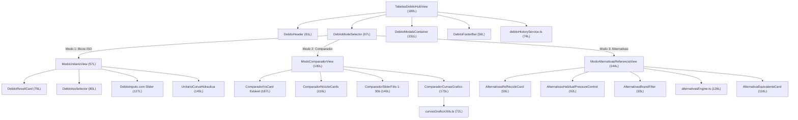

# 📋 Walkthrough de Implementação: Hub de Bicos Unificado (Tabelas de Débito)

> **Ambiente:** Servidor Local Vite (`http://localhost:5173/daterra-smart/`)  
> **Rota Canónica:** [`http://localhost:5173/daterra-smart/tools/tabelas-debito`](http://localhost:5173/daterra-smart/tools/tabelas-debito)  
> **Estado:** ✅ 100% Conforme, Modular (<200 linhas/ficheiro) & Aprovado em Testes

---

## 🎯 1. Arquitetura Modular do Hub de Bicos DATERRA Smart

A ferramenta **Tabelas de Débito (Comparador)** unifica o catálogo ISO 10625, o comparador técnico lado a lado e o motor multimarca por bico de referência. Todos os 3 modos operacionais operam agora com amplitude contínua de **1,0 a 30,0 bar**, pesquisa por tolerância legal de $\pm 10\%$ à mesma pressão e paginação progressiva:



---

## 🛠️ 2. Especificação das Novas Funcionalidades e Ergonomia

### 2.1 Motor de Alternativas à Mesma Pressão de Trabalho ($\pm 10\%$ de Tolerância)
- **Princípio Agronómico de Substituição Direta (*Drop-in Replacement*):**
  - O agricultor define o seu bico habitual e a respetiva pressão de trabalho do manómetro (ex.: Albuz ATR 80 Amarelo a **8,0 bar**, que debita **0,92 L/min**).
  - Em vez de forçar o agricultor a regular a válvula de pressão ou a rotação da TDF para pressões desconhecidas, o motor pesquisa todos os modelos multimarca que:
    1. Estejam homologados para trabalhar à pressão habitual ($P_{hab} \in [P_{min}, P_{max}]$).
    2. À mesma pressão $P_{hab}$, debitem o mesmo volume de calda com um desvio absoluto inferior ou igual a $\pm 10\%$ ($|\Delta\%| \le 10,0\%$, norma legal ISO 16122).
  - A ordenação lista prioritariamente os bicos com menor desvio de caudal ($\Delta\% \approx 0,0\%$) e tecnologias anti-deriva.

### 2.2 Apresentação Visual no Cartão de Bico Equivalente ([`AlternativaEquivalenteCard.tsx`](file:///c:/Users/pedro/OneDrive/Documentos/Projetos-Code/daterra-smart-app/src/features/calculators/tabelas-debito/components/AlternativaEquivalenteCard.tsx))
- **Visor de Débito à Mesma Pressão:**
  * Indicação clara: *"À mesma pressão (X,X bar) · Gama: Y–Z bar"*.
  * Débito apurado em fonte grande e de alta legibilidade.
  * Badge de desvio percentual colorido (`+X,X%` ou `-X,X%`).
  * Botão de ação rápida `[Comparar]` que envia o bico selecionado e a pressão para o Modo 2 (Comparador).

### 2.3 Paginação Progressiva (3 Linhas Iniciais + Carregamento Sob Procura)
- **Ergonomia e Performance Mobile-First:**
  * Inicialmente, são apresentadas apenas **3 linhas de bicos** (3 bicos em ecrãs móveis de coluna única; 6 bicos em ecrãs maiores de 2 colunas).
  * Quando existem mais modelos disponíveis dentro do filtro ativo, surge na base um botão tátil de alta visibilidade:  
    `[Mostrar mais bicos (+X)]`
  * O clique expande suavemente a grelha adicionando mais linhas progressivamente.
  * A troca de marca, pressão habitual ou bico de referência reinicia automaticamente a paginação para as 3 linhas iniciais.

### 2.4 Tipografia Centrada e Filtros em Flex-Wrap
- Texto informativo centrado:  
  *"Foram encontradas **XX** alternativas com débito equivalente a **X,XX L/min** (tolerância ±10%)"*
- Botões de seleção de marca alinhados à esquerda em grelha flexível com quebra automática de linha (`flex flex-wrap`), sem barras de scroll horizontais.

---

## 📏 3. Verificação de Governança Modular (< 200 Linhas)

Todos os 28 ficheiros sob `src/features/calculators/tabelas-debito/` cumprem rigorosamente o teto estrito de 200 linhas de código:

| Ficheiro | Linhas | Estado |
|---|:---:|:---:|
| `DebitoTrabalhoView.tsx` | **200** | ✅ Conforme ($\le 200L$) |
| `TabelasDebitoHubView.tsx` | **189** | ✅ Conforme ($\le 200L$) |
| `ComparadorVsCard.tsx` | **187** | ✅ Conforme ($\le 200L$) |
| `debitoTypes.ts` | **186** | ✅ Conforme ($\le 200L$) |
| `ModoAlternativasView.tsx` | **177** | ✅ Conforme ($\le 200L$) |
| `ComparadorCurvasGrafico.tsx` | **173** | ✅ Conforme ($\le 200L$) |
| `UnitarioCurvaHidraulica.tsx` | **145** | ✅ Conforme ($\le 200L$) |
| `ModoAlternativasReferenciaView.tsx` | **145** | ✅ Conforme ($\le 200L$) |
| `ComparadorSliderFitts.tsx` | **140** | ✅ Conforme ($\le 200L$) |
| `DebitoModalsContainer.tsx` | **131** | ✅ Conforme ($\le 200L$) |
| `ModoComparadorView.tsx` | **130** | ✅ Conforme ($\le 200L$) |
| `DebitoInputs.tsx` | **127** | ✅ Conforme ($\le 200L$) |
| `alternativasEngine.ts` | **126** | ✅ Conforme ($\le 200L$) |
| `ComparadorNozzleCards.tsx` | **119** | ✅ Conforme ($\le 200L$) |
| `AlternativaEquivalenteCard.tsx` | **118** | ✅ Conforme ($\le 200L$) |
| `ComparadorPressureKeypadCard.tsx` | **108** | ✅ Conforme ($\le 200L$) |
| `AlternativasHabitualPressureControl.tsx` | **92** | ✅ Conforme ($\le 200L$) |
| `DebitoHeader.tsx` | **81** | ✅ Conforme ($\le 200L$) |
| `DebitoIsoSelector.tsx` | **80** | ✅ Conforme ($\le 200L$) |
| `DebitoResultCard.tsx` | **79** | ✅ Conforme ($\le 200L$) |
| `debitoHistoryService.ts` | **74** | ✅ Conforme ($\le 200L$) |
| `curvasGraficoUtils.ts` | **72** | ✅ Conforme ($\le 200L$) |
| `DebitoModeSelector.tsx` | **67** | ✅ Conforme ($\le 200L$) |
| `AlternativasRefNozzleCard.tsx` | **59** | ✅ Conforme ($\le 200L$) |
| `ModoUnitarioView.tsx` | **57** | ✅ Conforme ($\le 200L$) |
| `DebitoFooterBar.tsx` | **56** | ✅ Conforme ($\le 200L$) |
| `AlternativasBrandFilter.tsx` | **33** | ✅ Conforme ($\le 200L$) |
| `index.ts` | **21** | ✅ Conforme ($\le 200L$) |

---

## 🧪 4. Bateria de Testes Automatizados (16/16 Aprovados)

Execução da suite oficial em `test/tabelas-debito.test.mjs`:

```
▶ Ferramenta Canónica: Tabelas de Débito (Comparador ISO 10625)
  ✔ 1. Débitos nominais exatos a 3.0 bar segundo a norma ISO 10625 (0.96ms)
  ✔ 2. Comportamento hidráulico proporcional à raiz quadrada da pressão (q = q0 * sqrt(P/3)) (0.22ms)
  ✔ 3. Cálculo exato da faixa de tolerância de desgaste ISO 16122 (±10%) (0.14ms)
  ✔ 4. Resiliência da função hidráulica a valores inválidos ou negativos (0.13ms)
  ✔ 5. Estruturação correta de StructuredValues para histórico v2 (0.22ms)
  ✔ 6. Geração de registo da Mutation Outbox com chave UUIDv4 e synced: 0 (1.82ms)
  ✔ 7. Indicador Delta Central (diferença percentual e identificação do bico líder) (0.36ms)
  ✔ 8. Salvaguarda agronómica de risco de deriva (DV10 < 100 µm) (0.17ms)
  ✔ 9. Verificação de pressão de trabalho e alerta de fora de escala (0.20ms)
  ✔ 10. Suporte multimarca e pesquisa de bicos alternativos (0.18ms)
  ✔ 11. Motor de Alternativas por Bico de Referência (findEquivalenceAlternatives) (1.39ms)
  ✔ 12. Curva Hidráulica ISO e tolerância visual (área sombreada ±10%) (0.17ms)
  ✔ 13. Slider Híbrido Fitts (snapping 0.5 bar e intervalo operacional) (0.10ms)
  ✔ 14. Segmentação dinâmica de curvas de bico no Comparador (curvasGraficoUtils) (0.50ms)
  ✔ 15. Marcador em losango para Bico B (getDiamondSvgPath) (0.12ms)
  ✔ 16. Suporte do filtro de marcas a "Todos" e amplitude de pressão até 30 bar (0.69ms)
✔ Ferramenta Canónica: Tabelas de Débito (Comparador ISO 10625) (8.70ms)

ℹ tests 16
ℹ pass 16
ℹ fail 0
```

---

## 🛡️ 5. Blindagem e Conectividade do Sistema

1. **Compilação TypeScript:** `npx tsc -b` finalizado com **0 erros**.
2. **Linter Estático:** `npm run lint` (oxlint) finalizado com **0 erros**.
3. **Servidor Local Vite:** Processo em background na porta `5173`. Responde **HTTP 200** na rota canónica [`http://localhost:5173/daterra-smart/tools/tabelas-debito`](http://localhost:5173/daterra-smart/tools/tabelas-debito).
4. **Blindagem Canónica:** As restantes 9 ferramentas canónicas e a persistência offline Outbox permanecem 100% blindadas e inalteradas.
